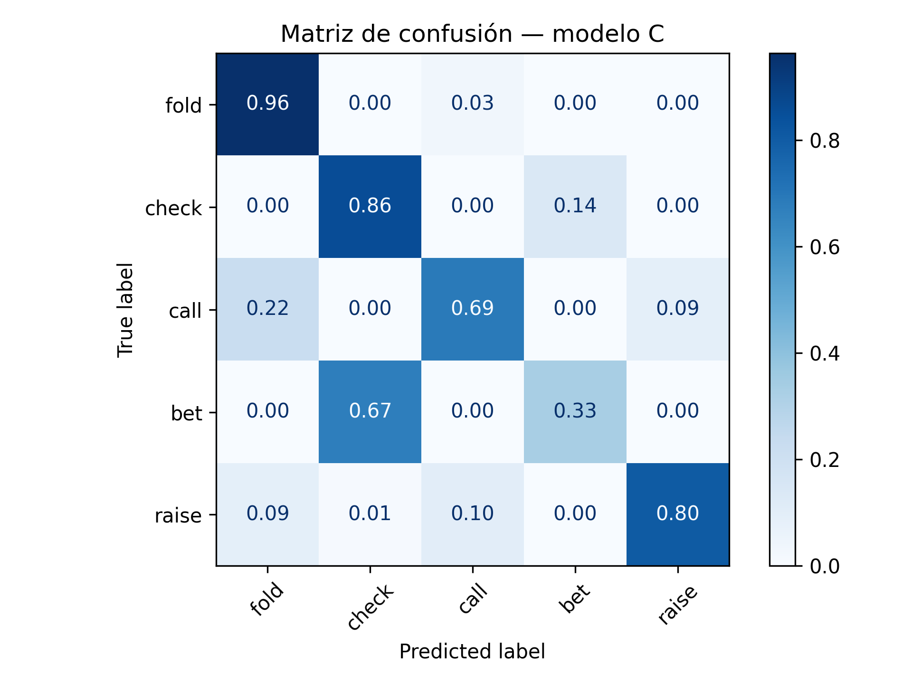

# Neural Approximation of Bayesian Game Strategies

Bachelor's thesis, B.Sc. in Mathematics, Universitat Autònoma de Barcelona.

Poker is a Bayesian game: each player knows their own cards but not the cards of the others.
Pluribus is an AI that beat professional players at six-player No-Limit Hold'em. This project
asks a simple question: can a small neural network learn to play like Pluribus just by
watching its hands?

I treat it as a supervised classification problem. The input is the state of the table at
the moment Pluribus has to act. The output is the action it took: **fold, check, call, bet
or raise**.

## Data

The data are the public hand histories of Pluribus: 10,000 hands split into sessions. The
logs are not in this repository; [data/README.md](data/README.md) explains where to get
them and where to put them.

`src/data_loader.py` parses the logs and replays each hand line by line: blinds, bets,
raises, the pot, each player's stack and who is still in the hand. Every time Pluribus has
to act, it saves the state of the table at that point together with the action it took.
The result is a dataset of 15,169 decisions.

As a check, the parser looks for impossible actions, such as a check when there is a bet to
call. It finds none, so the amount to call is rebuilt correctly.

## State representation

Each decision becomes a fixed-size vector. All values are scaled to [0, 1] with fixed game
constants (big blind, starting stack), not with statistics of the dataset.

My first design encoded the raw cards: 7 cards (2 private, 5 on the board), each as a rank
plus a one-hot suit, so 5 values per card. On top of that it added 5 domain features,
including the stack-to-pot ratio (SPR).

The final design is smaller. It has two parts:

- **Betting context**, the same in every version of the model: street, position, players
  still in the hand, players left to act, pot size, pot odds, SPR, number of bets and raises
  in the current street, and whether Pluribus made the last bet on the previous street.
- **Cards**, summarised the way a poker player would read them: the two private cards, the
  best hand made so far, what the board alone makes, the strength of a pair, flush and
  straight draws, and whether the board allows a flush or a straight.

Suits only matter through their relations (same suit or not), so no feature names a
specific suit.

I also trained the same network with the raw cards in place of the poker features. It does
as well before the flop, where there are only 169 different starting hands. After the flop
it does clearly worse: there are too many card combinations to learn from about 12,000
training examples.

[docs/CODIFICACION.md](docs/CODIFICACION.md) (in Spanish) describes every feature and the
experiments behind each choice.

## The data leak and how I fixed it

After the thesis, I reviewed the code and found that the first version leaked the answer
into the input. The parser updated the table *before* saving the decision:

- the pot already included the chips Pluribus was about to put in, so pot size and SPR
  showed whether it bet, called or raised;
- the count of active players already left Pluribus out when it folded.

The model could read part of the label from the input. Its accuracy looked good for the
wrong reasons.

The fix:

1. Save the state **before** applying Pluribus's action to the pot, the stacks or the list
   of active players. Every feature uses only what Pluribus could see when it decided.
2. Split train and test **by session**, not by single decisions. Decisions from the same
   session are related, and a random split puts near-copies of the same situation on both
   sides.
3. Scale features with fixed constants, so the test set does not affect training.

The thesis PDF in `docs/` reports the results of the original pipeline, before this fix.

## Model

A multilayer perceptron (scikit-learn `MLPClassifier`):

- two hidden layers (64 and 32 units, ReLU) and a softmax output over the 5 actions;
- Adam optimiser, L2 regularisation and early stopping;
- inputs standardised inside a pipeline, so the scaler is fitted on training data only.

Feature choices were compared with 5-fold cross-validation grouped by
session, using only the training sessions.

## Results

The test set is a group of sessions the model never saw during training.

| Model | Test accuracy |
|---|---|
| Always predict fold | 52.6 % |
| MLP | **84.6 %** |



The confusion matrix shows where the errors are. Fold, check and raise are predicted well.
Bet is the hardest action: Pluribus plays a mixed strategy, so in the same spot it sometimes
bets and sometimes checks. Part of that error cannot be removed by any model that only sees
the state.

`results/` also has the confusion matrix of the raw-card model and the permutation
importance of each feature.

## How to run it

Python 3.11.

```bash
pip install -r requirements.txt
# put the logs in data/pluribus_logs/ (see data/README.md)
python src/main.py
```

The script prints the class balance, the baseline, cross-validation and test metrics (per
action and per street) for both models, and saves the figures in `results/`. It runs in
under a minute on a laptop.

## Repository structure

```
.
├── data/
│   └── README.md          # where to get the logs
├── docs/
│   ├── Bachelor_Thesis.pdf
│   └── CODIFICACION.md    # feature-by-feature description (Spanish)
├── results/               # confusion matrices and feature importance
├── src/
│   ├── data_loader.py     # parse logs, rebuild the state before each decision
│   ├── state_encoder.py   # state -> feature vector
│   └── main.py            # split, baseline, training, evaluation
└── requirements.txt
```

## Author

Álvaro Martorell Ortuño, B.Sc. in Mathematics, Universitat Autònoma de Barcelona.
